# Cat Inhaler Kit: Printing and Assembly Manual

Parametric OpenSCAD designs for giving a cat its metered-dose inhaler (Ventolin / salbutamol type and similar pMDIs):
two mask adapters that push straight onto the inhaler mouthpiece, and a small valved holding chamber that goes between the inhaler and a mask.

The masks are exported for cats of **3.3, 4, 5 and 6 kg** (see [Pick the mask size](#22-pick-the-mask-size)); the chamber fits all of them. Every part is made for a mouthpiece of **25.4 x 19.6 mm**. Size and mouthpiece are easy to change, see [Customising](#9-customising-and-regenerating-the-stls).

> **Please read.** These are hobby designs, not medical devices. Use them only with your veterinarian's guidance, follow the vet's dosing instructions, check every printed part for sharp edges and loose strands before it goes near your cat, and never force a mask on a struggling animal. The valves are printed approximations of the silicone valves in commercial chambers and have not been laboratory tested.

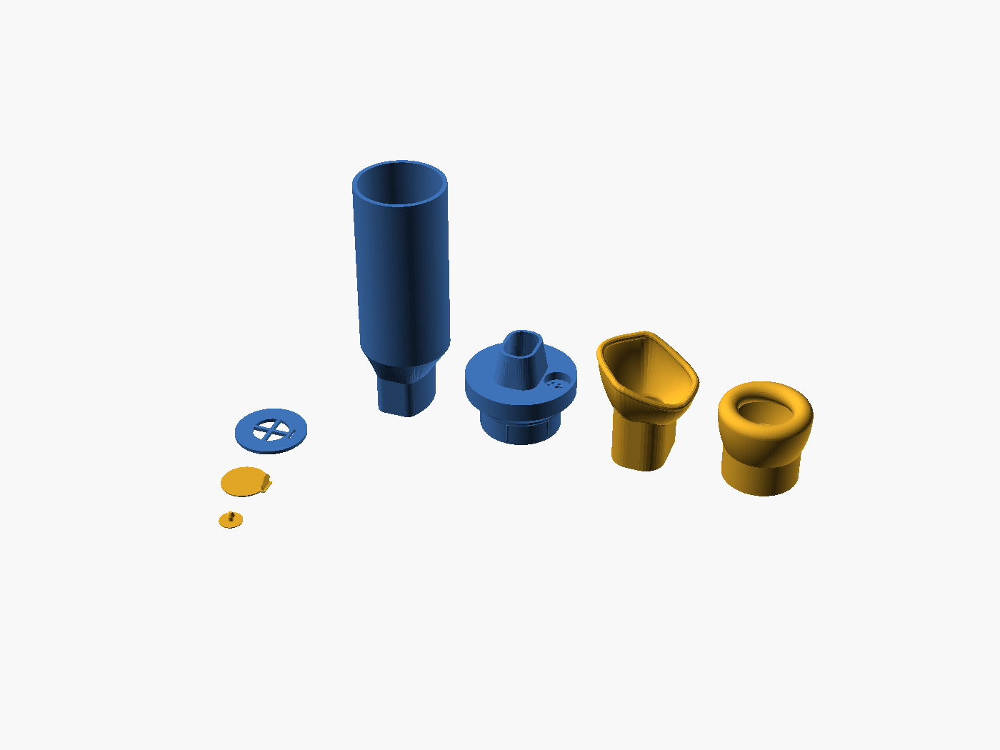

*All parts as exported, in print orientation: TPU parts amber, rigid (PETG/PLA) parts blue.*

---

## 1. What is in the kit

| Part | File | Printed in | What it does |
|---|---|---|---|
| Cat face mask | `stl/<size>/cat_face_inhaler_mask_<size>.stl` | TPU | Anatomical mask with a tilted rim (deeper under the chin). Remake of the "ventolin cat face v4" design. |
| Round cushion mask | `stl/<size>/round_cushion_inhaler_mask_<size>.stl` | TPU | Round mask with a hollow rolled lip that acts as a soft cushion. Remake of the "inhalateur2" design. |
| Paper template | `stl/<size>/cat_face_rim_template_<size>.svg` | paper | 1:1 outline of the cat face mask rim to hold against the cat before printing. |
| Chamber body | `stl/common/holding_chamber_body.stl` | PETG or PLA | Inhaler socket, inlet cone and 40 mm tube (about 105 ml). |
| Chamber cap | `stl/common/holding_chamber_cap.stl` | PETG or PLA | Lid with the mask nozzle and the two valve seats. Crush ribs on its skirt hold it in the body. |
| Inhalation valve insert | `stl/common/holding_chamber_valve_insert.stl` | PETG or PLA | Disc with a grille and a hinge slot. Seat for the flap. |
| Inhalation flap | `stl/common/holding_chamber_valve_flap.stl` | TPU | 0.6 mm flap with a hinge tab printed standing up. Opens when the cat breathes in. |
| Exhalation umbrella | `stl/common/holding_chamber_umbrella.stl` | TPU | 0.4 mm umbrella valve. Lets exhaled air out of the cap. |
| One-piece spacer | `stl/common/holding_chamber_one_piece_spacer.stl` | PETG or PLA | Alternative: body and cap fused, no valves. Simplest print. |
| Socket test | `stl/common/holding_chamber_socket_test.stl` | PETG or PLA | Optional: only the inhaler socket end of the body (5 g). Print it first to try your inhaler, see [2.1](#21-measure-your-inhaler-mouthpiece). |

`<size>` is one of `3.3kg`, `4kg`, `5kg`, `6kg`. Source files (in `scad/`): `cat_face_inhaler_mask.scad`, `round_cushion_inhaler_mask.scad`, `holding_chamber.scad`.

### Parts gallery

| | | |
|---|---|---|
| 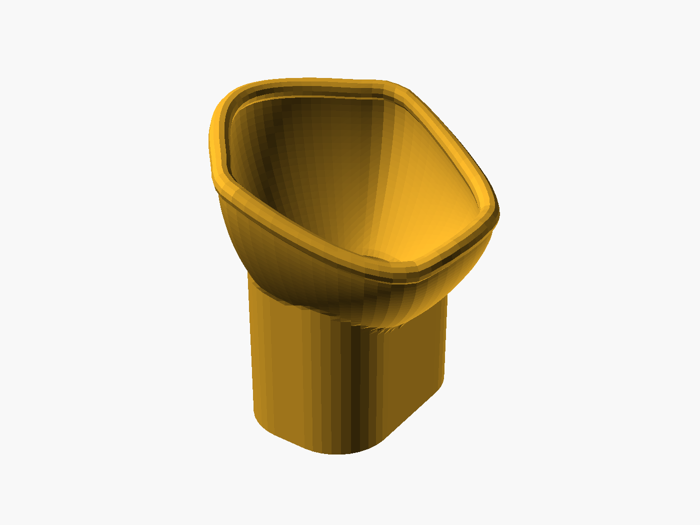 Cat face mask | 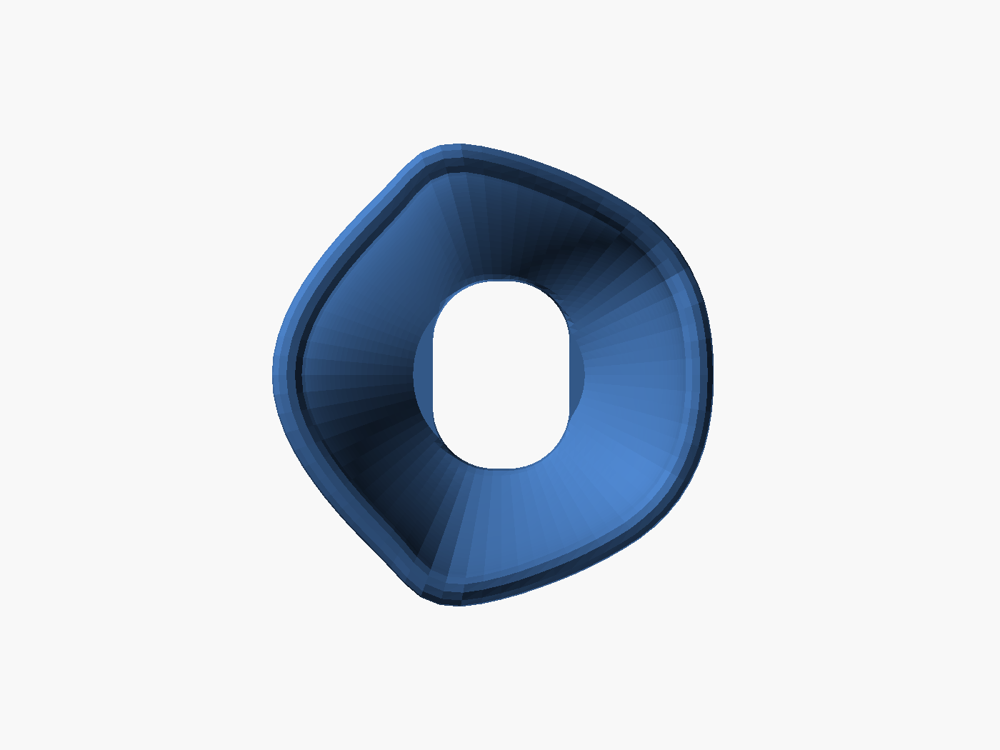 Cat face mask, face side | 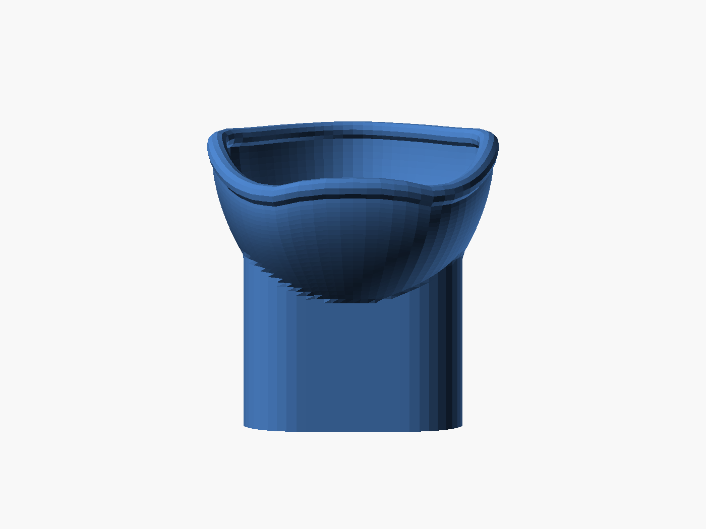 Cat face mask, side (rim tilt) |
| 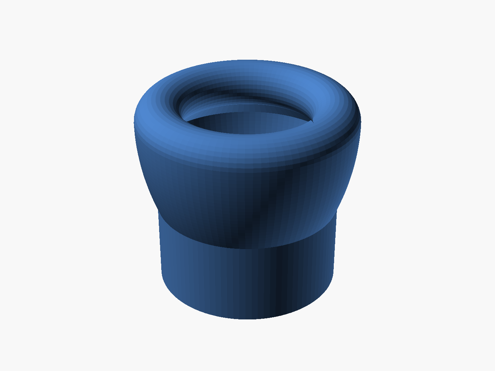 Round cushion mask | 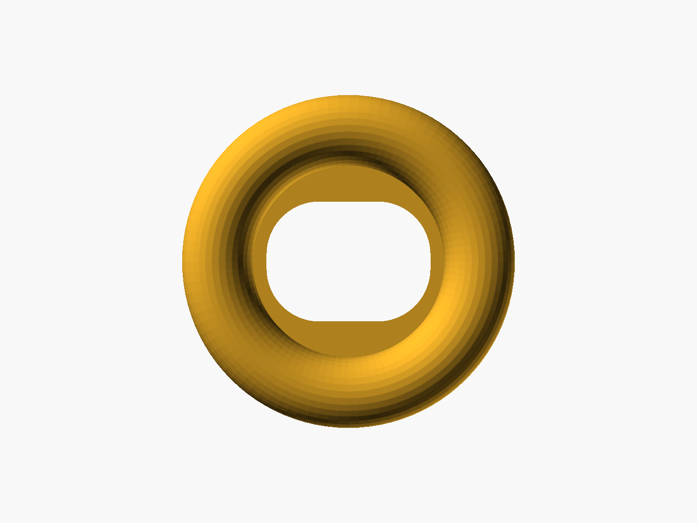 Round cushion mask, face side | 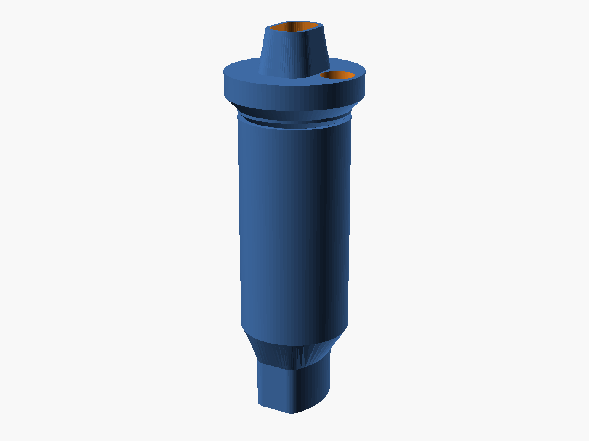 Chamber, assembled |
| 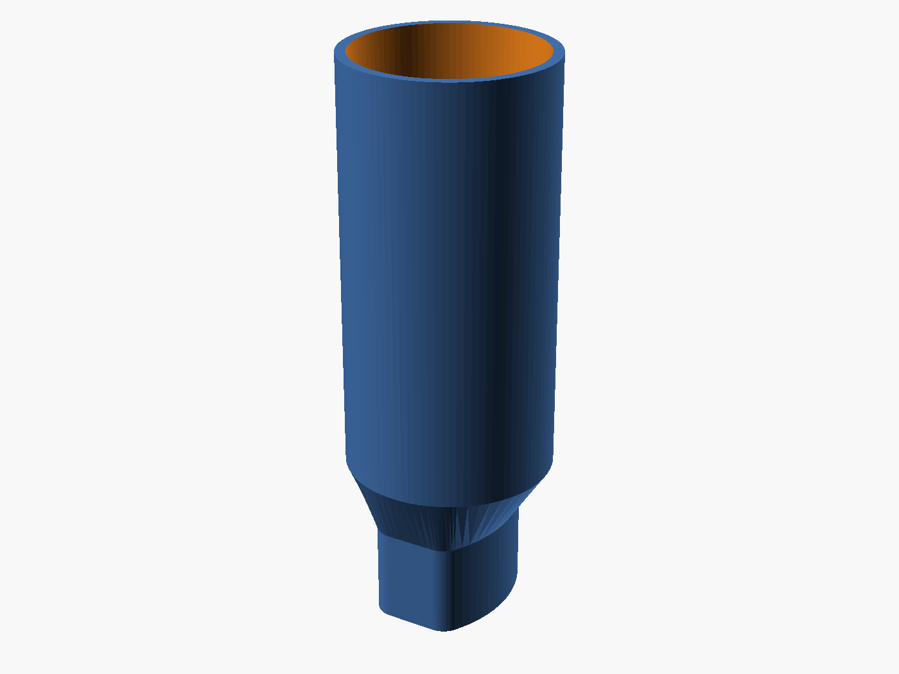 Chamber body | 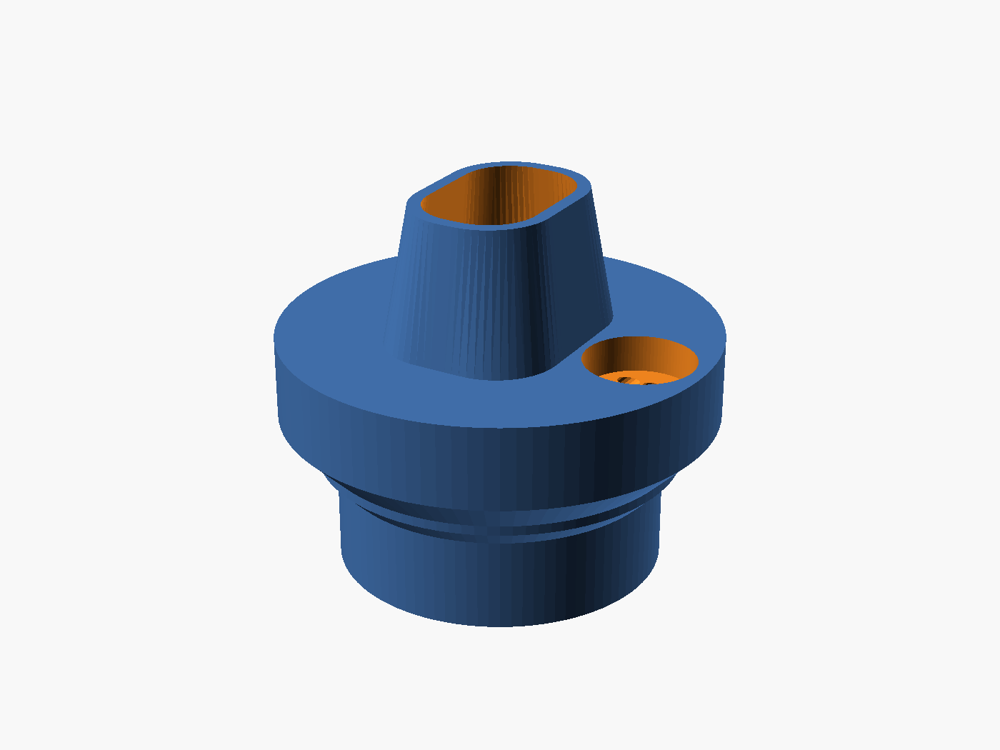 Chamber cap | 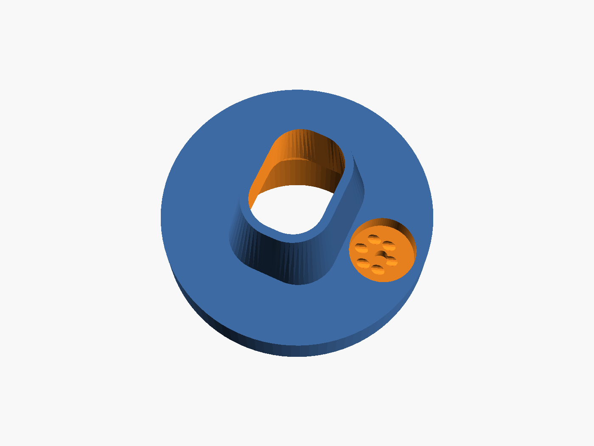 Cap lid: nozzle and exhalation pocket |
| 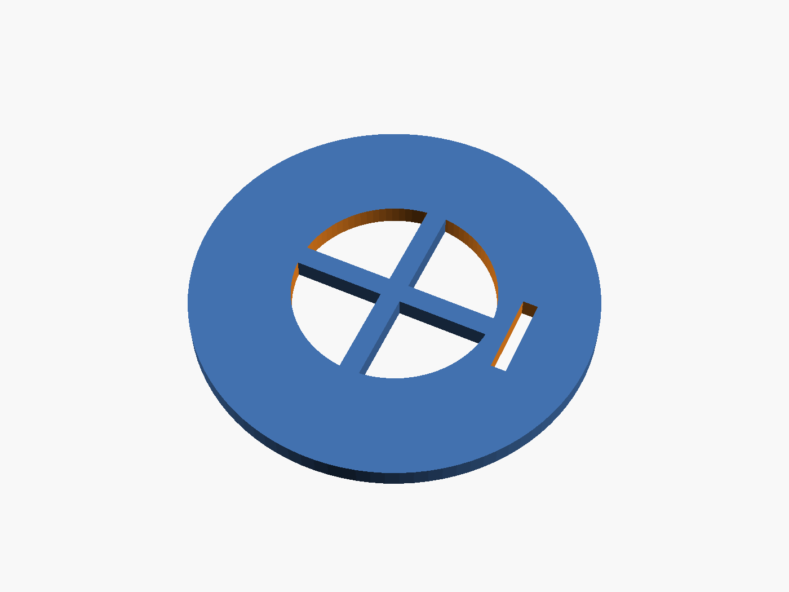 Inhalation valve insert | 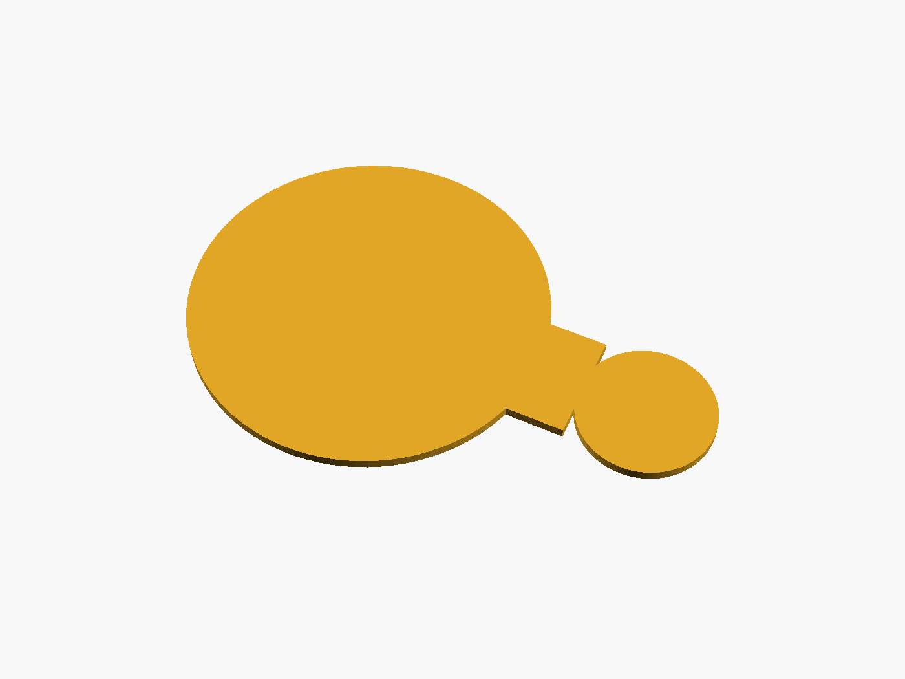 Inhalation flap | 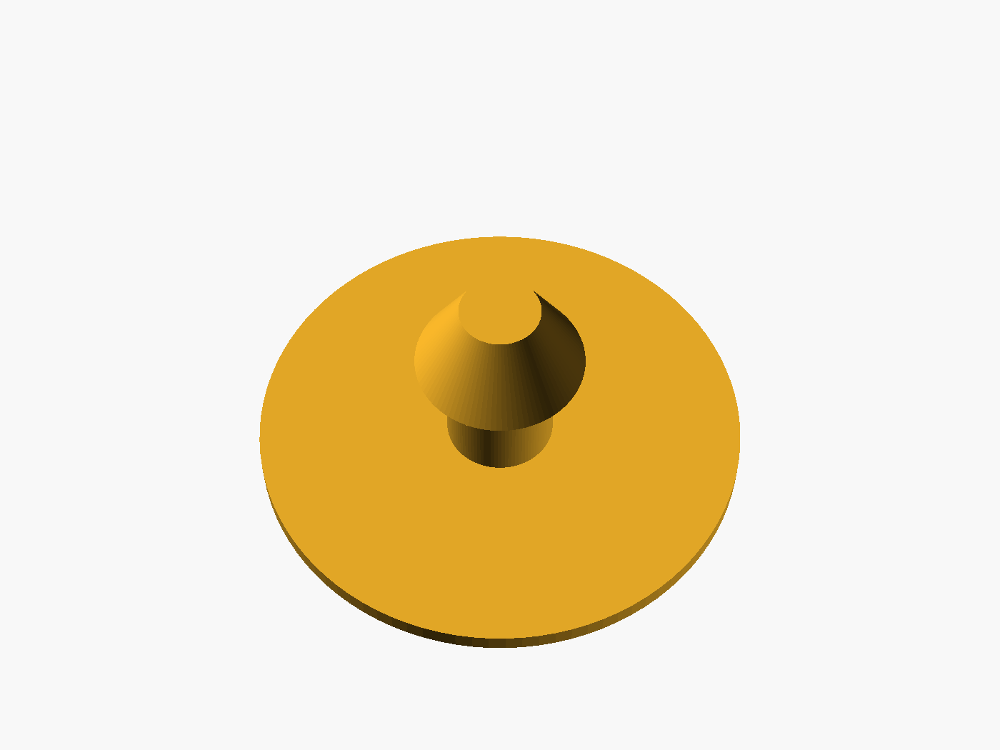 Exhalation umbrella |

Renders are from OpenSCAD with the default parameters (masks for 3.3 kg); the one-piece spacer is shown in section 3.

### How the pieces go together

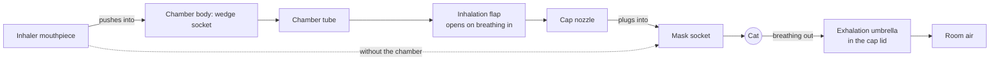

An inhaler can also be pushed **directly into a mask** without the chamber: the soft TPU mask socket stretches around the mouthpiece. The chamber nozzle is a rounded rectangle of the mouthpiece's size, so it plugs into the same mask socket. The chamber body is rigid and cannot stretch, so its socket follows the real outline of the mouthpiece instead (see 2.1).

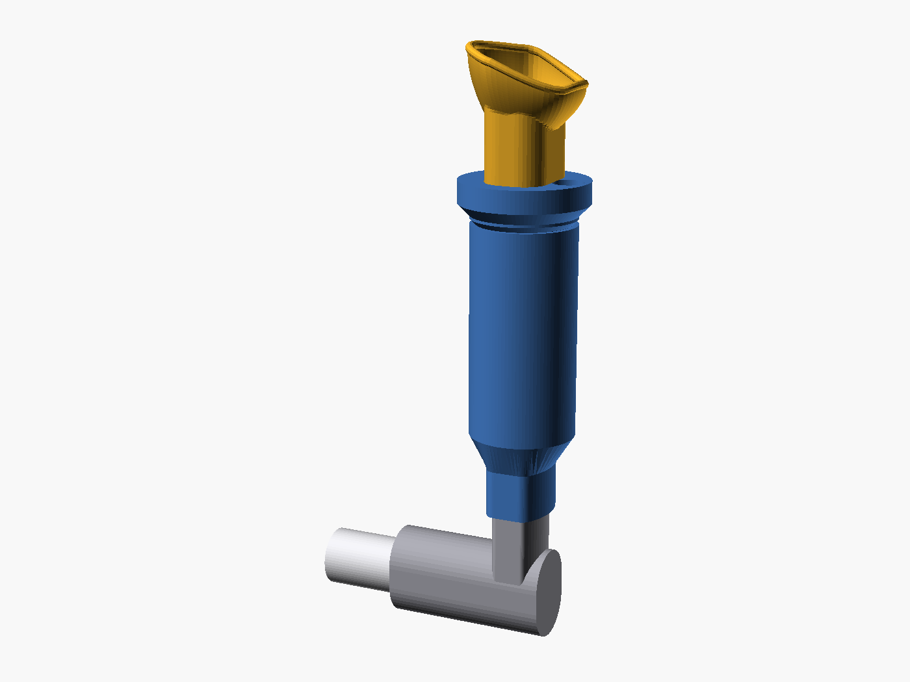

---

## 2. Before you print

### 2.1 Measure your inhaler mouthpiece

The defaults are for the GSK Ventolin HFA / Evohaler actuator, which the albuterol (salbutamol) HFA authorised generics use too: **25.4 x 19.6 mm**. Seen end on, its mouthpiece is not a plain rounded rectangle but a "barrel": the two short ends are straight, the two long sides bulge outwards (about 12 mm high next to the corners, 19.6 mm in the middle), and the corners are small, about 2 mm.

No datasheet publishes these numbers. They are fitted to two published sockets that were made for a Ventolin and both have this outline: city17's [Bottle Adapter for Cat Asthma Inhaler](https://www.printables.com/model/848067) (a rigid socket of 25.4 x 19.6 mm at the mouth, by the author of the "ventolin cat face v4" mask) and bens' [Vase Mode Ventolin Inhaler Spacer](https://3d.nih.gov/entries/3DPX-018151) (25.4 mm wide, a thin wall that flexes over the bulge). Photos of a mouthpiece and its dust cap agree. (The "inhalateur2" design used a 24 x 17.5 mm stadium hole without taper, a deliberately tight TPU fit.) If you can, check your own inhaler with calipers:

1. **Long outer width** of the mouthpiece tip: `inhaler_w` in the chamber file, `mouth_w` in the mask files.
2. **Short outer height in the middle** of the long sides, where they bulge most: `inhaler_h` (chamber), `mouth_h` (masks).
3. **Short outer height at the ends**, just inside the corners: `inhaler_end_h` (chamber). Make it equal to `inhaler_h` for a mouthpiece with flat sides.
4. **Corner radius**: `inhaler_corner_r` (chamber). Err on the small side. The masks use one rounded rectangle, `mouth_corner_r`, and the TPU stretches to the real shape.

The two mask files and the chamber file must agree on `mouth_w`, `mouth_h` and `mouth_corner_r`, because the chamber nozzle plugs into the mask socket. Re-export after a change.

The mask sockets (TPU) taper by 4 mm over 15 mm and stretch around the mouthpiece. The chamber socket (rigid PETG) starts `inhaler_fit` = 0.6 mm larger than the mouthpiece behind a 1 mm lead-in chamfer and narrows by 2 mm over 15 mm. A mouthpiece of exactly the default size wedges about 4.5 mm deep, and the tip of a real mouthpiece is usually a little smaller, so it goes deeper. Every 0.1 mm that yours is smaller moves that 0.75 mm deeper, so a mouthpiece down to 24 x 18.2 mm still wedges. To check before printing the whole body, print `holding_chamber_socket_test.stl`, which is the socket end alone, and push your inhaler in: it should go in 3 to 12 mm and stop firmly. If it stops sooner, raise `inhaler_fit` by 0.4; if it goes in further or wobbles, lower it by 0.4.

### 2.2 Pick the mask size

Mask size scales from `cat_weight_kg` using the cube root of the weight ratio, relative to an assumed 4.5 kg cat for the original design. Only the cup and rim scale; the inhaler socket is the same in every size, so every mask fits the inhaler and the chamber nozzle. Four sizes are exported ready to print:

| Cat weight | Folder | Scale | Cat face mask rim (outer) | Cat face mask height | Round mask diameter | Round mask height |
|---|---|---|---|---|---|---|
| 3.3 kg | `stl/3.3kg/` | 0.90 | 42.7 x 44.3 mm | 48.8 mm | 39.7 mm | 35.8 mm |
| 4 kg | `stl/4kg/` | 0.96 | 45.5 x 47.2 mm | 50.6 mm | 42.3 mm | 36.9 mm |
| 5 kg | `stl/5kg/` | 1.04 | 49.1 x 50.9 mm | 52.8 mm | 45.6 mm | 38.3 mm |
| 6 kg | `stl/6kg/` | 1.10 | 52.1 x 54.1 mm | 54.7 mm | 48.4 mm | 39.4 mm |

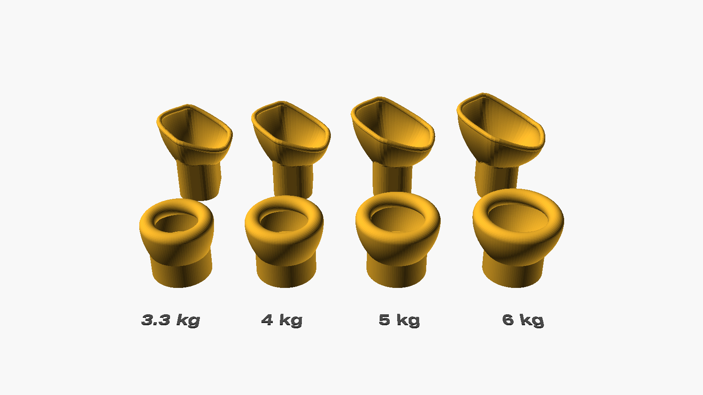

Weight is only a starting point. Face size depends on breed and build, and an overweight cat does not have a bigger face. Check with the paper template before printing:

1. Print `stl/<size>/cat_face_rim_template_<size>.svg` at 100 % scale and check the 50 mm bar with a ruler. Printing the two sizes nearest your cat's weight makes the comparison easy.
2. Hold the paper against your cat's face. The outline must cover nose and mouth with the whiskers folded, and stay below the eyes.
3. Pick the size that fits. If none does, set `cat_weight_kg` in the mask file to an in-between value, or set `rim_length` / `rim_width` (cat face) or `rim_d` (round) in millimetres. Then export the mask and, from the cat face file with `part = "template"`, a new template (F6, export SVG).

The round mask has no template: its rim is a circle of the diameter in the table, 3 to 5 mm smaller than the cat face mask rim of the same size.

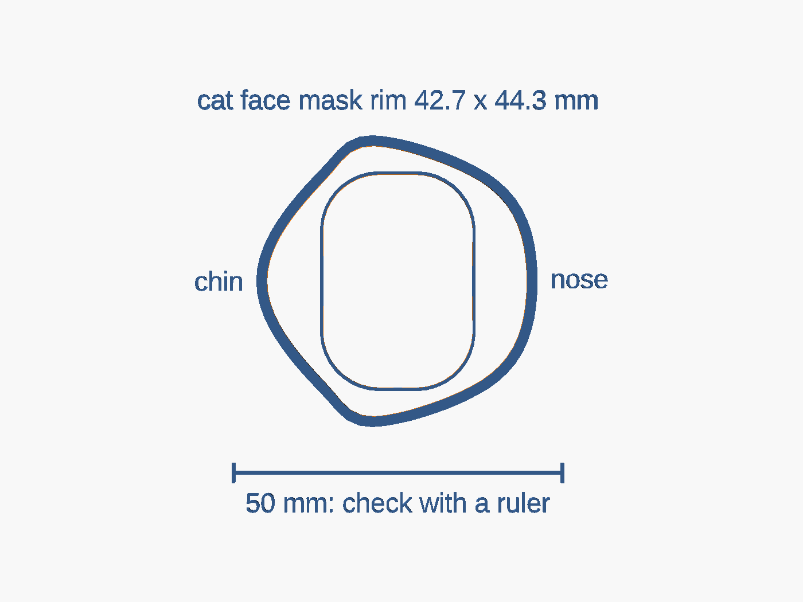

### 2.3 Which mask?

| | Cat face mask | Round cushion mask |
|---|---|---|
| Shape | Follows the muzzle: wide and shallow over the nose, narrow and deep under the chin | Symmetric cone, no orientation to get wrong |
| Seal | Rim bead on the face | Hollow rolled lip, softer and more forgiving |
| Printing | Easiest, no bridging | The lip's hollow roof is bridged by the slicer; needs a printer that handles small TPU bridges |
| Try first if | your cat holds still and you want the lowest dead space | your cat moves a lot, or the cat face mask does not seal |

---

## 3. Printing

All parts print in the orientation of the STL files, without supports.

### 3.1 TPU parts (masks, flap, umbrella)

Tested target: TPU 95A on a 0.4 mm nozzle (direct drive preferred; Bowden works at lower speed).

| Setting | Masks | Flap and umbrella |
|---|---|---|
| Layer height | 0.2 mm | 0.2 mm (the flap disc is exactly 3 layers, the umbrella disc 2) |
| Perimeters | 4 (cup wall 1.6 mm), 5 or more for the stem (2.0 mm) | 3+, 100 % infill |
| Infill | not needed, the parts are solid walls | 100 % |
| Top/bottom layers | 3 | n/a |
| Speed | 20 to 30 mm/s outer walls, 15 mm/s first layer | 15 to 20 mm/s |
| Temperature | 220 to 235 C nozzle, 40 to 50 C bed | same |
| Fan | 50 to 100 % after layer 2 | 100 % |
| Retraction | short (1 to 2 mm direct drive), slow; disable coasting/wipe | same |
| Adhesion | clean PEI, no glue; a 3 mm brim if the stem lifts | brim 2 to 3 mm, the parts are tiny |
| Supports | none | none |

Notes:

- The mask wall is a multiple of the 0.4 mm line width (1.6 mm = 4 lines), so set perimeters high enough that the slicer fills the whole wall with walls and no gap fill.
- Round cushion mask: the hollow inside the rolled lip is bridged by the slicer over about 5 mm. Expect a rough interior; it is invisible and harmless. If your printer bridges TPU badly, set `lip_style = "bead"` for a solid rim.
- Flap: print disc down, with the hinge tab standing up at the edge as in the STL (6.6 mm tall, 0.8 mm = 2 lines thick). Do not lay the tab flat: it has to come off the bed already bent at 90 degrees, otherwise it springs back once it is through the slot and lifts the disc off the seat.
- Umbrella: print disc down, stem up (the part is 4.3 mm tall). Print two or three at once a few centimetres apart so each stem gets cooling time between layers. If the thin disc warps, print with a draft shield or at lower temperature.
- TPU is hygroscopic: dry the filament before printing thin parts, otherwise the flap and umbrella will be porous.

### 3.2 Rigid parts (chamber body, cap, insert, one-piece spacer)

PETG is the first choice (tough, dishwasher-safe at low temperature, less static than PLA). PLA works but do not wash it in hot water. The chamber can also be printed in TPU with `wall = 2` if you want everything soft, but it will be squeezable.

| Setting | Value |
|---|---|
| Layer height | 0.2 mm |
| Perimeters | 5 (wall 2.0 mm = 5 lines) |
| Infill | irrelevant, the parts are all walls; 100 % for the insert |
| Top/bottom layers | 4 |
| Speed | 40 to 60 mm/s |
| Temperature (PETG) | 235 to 250 C nozzle, 75 to 85 C bed |
| Fan | 30 to 50 % |
| Adhesion | brim 5 mm on the 110 mm tall body; the socket end is small |
| Supports | none. Overhangs are 45 degrees or less by design (inlet cone 33, ceiling cone 37, lid flare 45, exhalation holes 45). The blind bulb pocket and the stem hole are bridged over 2 to 4 mm. |

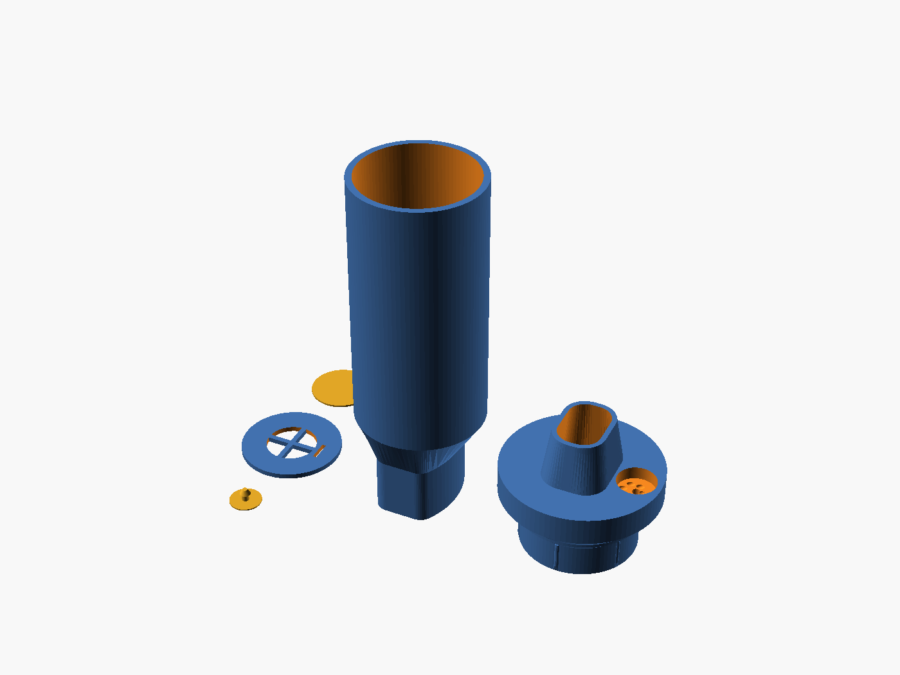

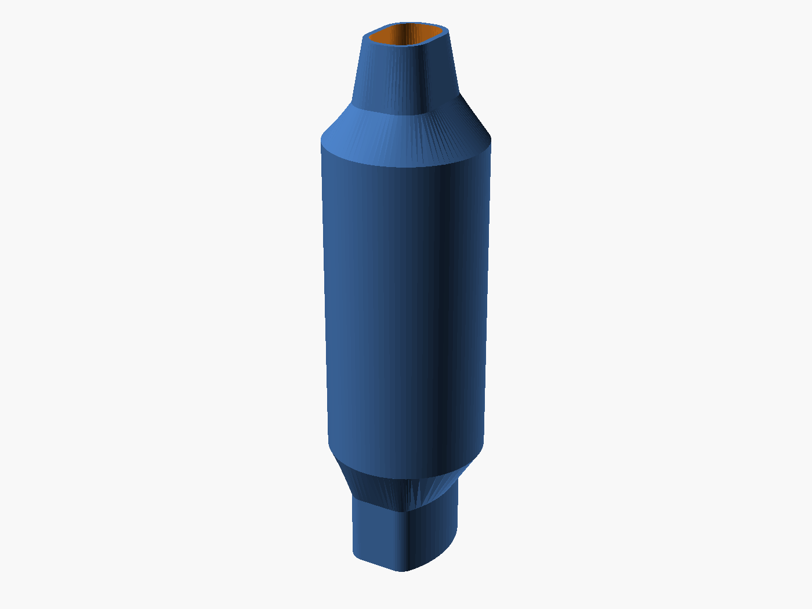

### 3.3 Part sizes and material

| Part | Size (mm) | Volume | Approx. weight |
|---|---|---|---|
| Cat face mask, 3.3 kg | 44 x 46 x 49 | 12.6 cm3 | 15 g TPU |
| Cat face mask, 4 kg | 47 x 49 x 51 | 13.1 cm3 | 16 g TPU |
| Cat face mask, 5 kg | 51 x 53 x 53 | 13.8 cm3 | 17 g TPU |
| Cat face mask, 6 kg | 54 x 56 x 55 | 14.5 cm3 | 18 g TPU |
| Round cushion mask, 3.3 kg | 40 x 40 x 36 | 13.3 cm3 | 16 g TPU |
| Round cushion mask, 4 kg | 42 x 42 x 37 | 13.9 cm3 | 17 g TPU |
| Round cushion mask, 5 kg | 46 x 46 x 38 | 14.7 cm3 | 18 g TPU |
| Round cushion mask, 6 kg | 48 x 48 x 39 | 15.6 cm3 | 19 g TPU |
| Chamber body | 40 x 40 x 110 | 27.6 cm3 | 35 g PETG |
| Chamber cap | 49 x 49 x 41 | 21.0 cm3 | 27 g PETG |
| Valve insert | 32 x 32 x 1.6 | 1.0 cm3 | 1 g |
| Inhalation flap | 21 x 20 x 6.6 | 0.2 cm3 | under 1 g TPU |
| Exhalation umbrella | 10 x 10 x 4.3 | 0.05 cm3 | under 1 g TPU |
| One-piece spacer | 40 x 40 x 136 | 31.0 cm3 | 39 g PETG |

Assembled chamber: 141 mm long, 49 mm at the lid. With a mask on the nozzle add about 34 mm.

---

## 4. Post-processing

1. Remove brims and any stringing. Look inside the sockets and the nozzle for strands.
2. Run a finger around every rim that touches the cat. Sand or trim anything sharp. TPU rims should feel smooth.
3. Check the flap and umbrella against a light: no holes, no thin spots. Print spares, they are cheap.
4. Wash everything in warm water with a drop of dish soap, rinse, and let it **air dry without wiping**. This also reduces static on the chamber walls, which otherwise steals aerosol. Repeat weekly.

---

## 5. Assembly

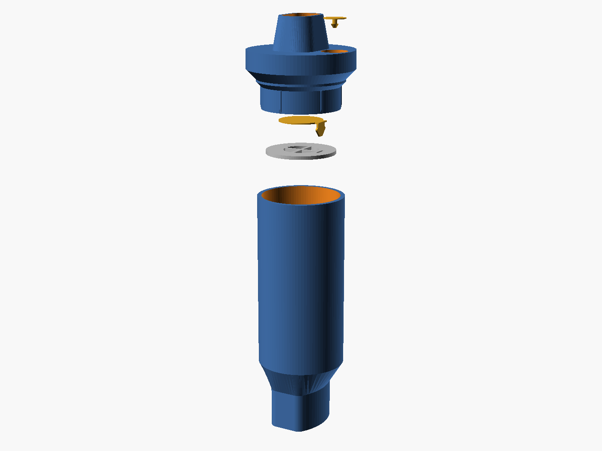

### 5.1 Inhalation valve

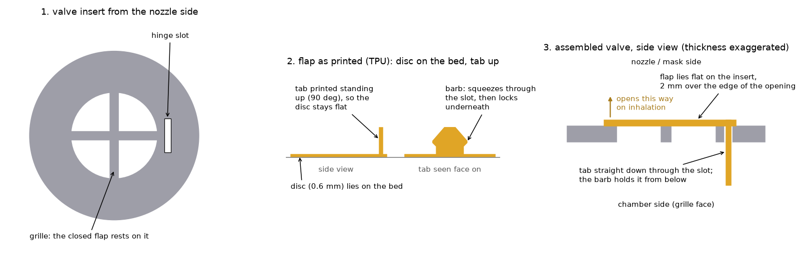

1. Hold the **insert** so that the face that will point to the nozzle is up. The insert is symmetric, either face works.
2. Push the **flap's tab**, pointed barb first, down through the **slot** at the edge of the opening. Grip the point from below and pull until the barb pops through. The barb is wider than the slot and squeezes through, then holds underneath.
3. The disc now lies flat on the insert, covering the opening with about 2 mm overlap all round, and the lip under the tab covers the slot. The face that was on the print bed faces the nozzle.
4. Test: blow gently through the grille from below, the flap should lift. Blow from above, it should seal on the grille.

### 5.2 Valve insert into the cap

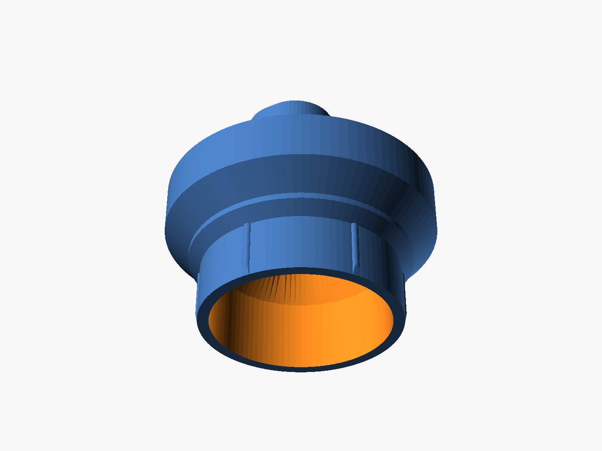

1. Turn the **cap** upside down (nozzle on the table, skirt up).
2. Drop the insert into the skirt **flap first** (flap towards the nozzle, grille towards you).
3. Push it in until it stops against the cone. It is a 0.1 mm press fit; press firmly with a flat object. If it will not go in, scrape the edge lightly or set `insert_clearance = 0` and reprint. If it rattles, a drop of silicone sealant or hot glue on the edge holds it.

### 5.3 Exhalation umbrella into the cap


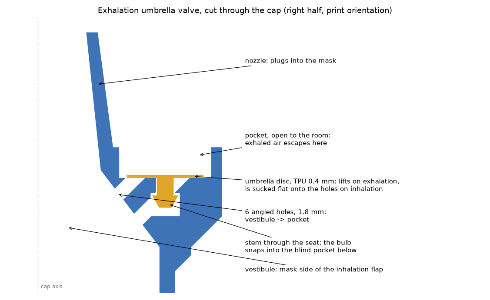

1. Turn the cap right side up. Next to the nozzle there is a round **pocket** in the lid with six small angled holes and one slightly larger centre hole.
2. Push the **umbrella stem** into the centre hole, bulb first, until it clicks. The seat is 2 mm thick; the bulb snaps into a blind pocket underneath and holds the umbrella down.
3. The disc must lie flat on the pocket floor and cover all six holes. Test: suck gently on the nozzle, the umbrella is pulled flat and seals. Blow into the nozzle, the rim lifts and air escapes from the pocket.
4. To remove it for cleaning, pull the disc straight up; the bulb squeezes back through the hole.

### 5.4 Cap onto body

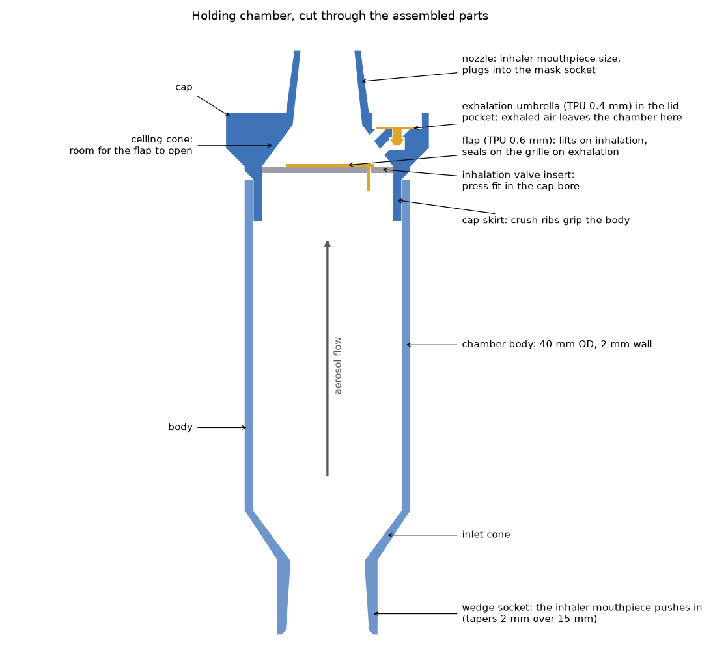

1. Push the cap **skirt** into the open end of the body until the lid's flare sits on the rim of the body.
2. Six crush ribs on the skirt reach 0.25 mm into the body wall and flatten a little the first time the skirt goes in, so the cap holds firmly whatever your printer's tolerance. The first push is the hardest. If the cap is still loose, raise `skirt_rib_interference` by 0.1 and reprint the cap; if it will not go in, lower it by 0.1. A turn of PTFE tape on the skirt is a quick fix. Do not glue it, you need to open it for cleaning.

### 5.5 Inhaler and mask

1. Push the **inhaler mouthpiece** into the socket at the bottom of the body. The chamfer at the mouth guides it in, and it wedges after 5 to 10 mm.
2. Push the **mask** firmly onto the **nozzle** on top of the cap. The nozzle is 0.4 mm larger than the inhaler mouthpiece (`nozzle_oversize`), so it stretches the TPU socket and grips; the mask may stop a millimetre or so short of the lid.
3. Without a chamber: push the inhaler straight into the mask socket instead.

### 5.6 Function check before first use

- Breathe in through the nozzle (mask off): air flows freely through the chamber and the inhaler's own air inlets, the flap opens.
- Breathe out into the nozzle: the flap closes and your breath leaves through the umbrella pocket. You should feel very little resistance.
- Hold the assembled chamber up to a light and check that nothing is cracked.

---

## 6. Fitting the mask to the cat

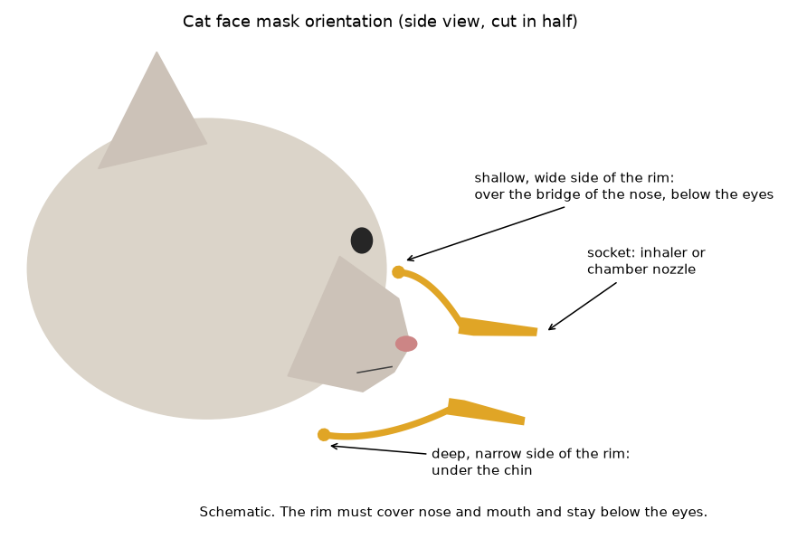

- **Cat face mask orientation:** the rim is tilted. The **deep, narrow** side goes **under the chin**; the **shallow, wide** side sits over the **bridge of the nose**, just below the eyes. The inhaler socket then points forward and slightly down.
- **Round mask:** no orientation. Centre the lip on the nose and mouth.
- The rim must cover nose and mouth. It does not have to be airtight: fur never seals perfectly, and the exhalation valve means the cat does not have to push air out past the rim.
- Let the cat sniff the mask and chamber first, reward with treats, and build up over several days with the mask alone before adding the inhaler. Many cats accept it best when wrapped loosely in a towel on your lap.

Operating sequence (confirm with your vet): shake the inhaler, fit mask and chamber, place the mask on the face, actuate one puff into the chamber, keep the mask in place for 7 to 10 breaths (watch the chest), remove, praise. Wait as the vet instructs between puffs.

---

## 7. Cleaning and maintenance

| Item | How often | How |
|---|---|---|
| Masks | after each use | rinse; weekly warm water + dish soap, air dry |
| Chamber body and cap | weekly | take apart, warm water + a drop of dish soap, rinse, air dry without wiping |
| Flap and umbrella | weekly | inspect for tears or curl; replace if they no longer lie flat |
| Everything | monthly | check the socket grip on the inhaler; reprint the mask or raise `socket_taper` if it has loosened |

Do not boil, dishwash on hot, or leave in a sunny car: TPU and PLA deform.

---

## 8. Troubleshooting

| Problem | Fix |
|---|---|
| Inhaler will not go into the chamber socket | Raise `inhaler_fit` in `holding_chamber.scad` by 0.4 (it then goes in 3 mm deeper) and print the socket test first. If the corners catch, measure the mouthpiece outline ([2.1](#21-measure-your-inhaler-mouthpiece)). |
| Inhaler loose in the chamber socket | Lower `inhaler_fit` by 0.4. |
| Inhaler will not go into a mask | TPU shrinks a little. Set `socket_clearance = 0.3` in the mask file and reprint, or enlarge `mouth_w` / `mouth_h` after measuring. |
| Inhaler falls out of a mask | Set `socket_clearance = -0.2` or raise `socket_taper` to 5 in the mask file. |
| Chamber nozzle loose in the mask | Raise `nozzle_oversize` (default 0.4) to 0.6 or 0.8 in `holding_chamber.scad` and reprint the cap. If the mask is too hard to push on, lower it. |
| Cap falls out of the body | Raise `skirt_rib_interference` (default 0.25) by 0.1 and reprint the cap. If the cap is too hard to push in, lower it by 0.1. |
| Mask too big / too small | Try the next size folder. Between sizes, change `cat_weight_kg`, or set `rim_length` / `rim_width` (cat face) or `rim_d` (round) in mm. Print the paper template first. |
| Flap sticks or does not close | Make sure it lies flat. Its tab must be printed standing up, as in the STL: a tab printed flat (older versions of this file) springs back and lifts the disc. A flap printed with wet filament curls: dry the TPU. |
| Umbrella leaks on inhalation | The disc must be flat on the pocket floor. Reprint at 0.4 mm with 100 % infill; check the pocket floor for strings. |
| Cat resists exhaling | Check the umbrella moves freely. Never block the pocket. |
| Visible aerosol escaping around the rim | Normal in small amounts. Check the cat face mask orientation; try the round mask. |
| Rough or weak thin TPU parts | Dry the filament, slow down to 15 mm/s, raise temperature 5 C. |

---

## 9. Customising and regenerating the STLs

Open a `.scad` file in OpenSCAD (2021.01 or newer), change parameters in the Customizer panel or in the file, press **F6** to render, then **File > Export > STL**.

Parameters you will most likely touch:

| File | Parameter | Meaning |
|---|---|---|
| all three | `mouth_w`, `mouth_h`, `mouth_corner_r` | your inhaler mouthpiece as a rounded rectangle: the mask sockets and the chamber nozzle (use the same values everywhere) |
| masks | `socket_taper`, `socket_clearance` | grip of the mask sockets |
| chamber | `inhaler_w`, `inhaler_h`, `inhaler_end_h`, `inhaler_corner_r` | the real mouthpiece outline, for the rigid chamber socket |
| chamber | `inhaler_fit`, `socket_taper` | how deep the inhaler goes into the chamber socket before it wedges (echoed in the console) |
| masks | `cat_weight_kg` or `rim_length` / `rim_width` / `rim_d` | mask size |
| masks | `cup_wall`, `lip_d` / `lip_r` | wall and rim softness |
| cat face mask | `part = "template"` | 2D rim template for paper |
| chamber | `chamber_d`, `chamber_len` | chamber volume (echoed in the console) |
| chamber | `skirt_rib_interference`, `nozzle_oversize` | grip of the cap in the body and of the nozzle in the mask |
| chamber | `valve`, `exhale_valve`, `one_piece` | valved holding chamber or plain spacer |
| chamber | `part` | `all`, `body`, `cap`, `insert`, `flap`, `umbrella`, `assembly`, `exploded` |
| all three | `show_section` | cut the model in half to inspect it |

### Regenerating everything from the command line

`scripts/render.py` rebuilds the STLs and paper templates for every size and all images in `docs/img/` from the `.scad` files, so after changing a default in a `.scad` file one command brings the whole repo up to date. The cat weights it exports are the `SIZES` list at the top of the script; the images in `docs/` show the 3.3 kg masks. It needs Python 3.8+ and OpenSCAD 2021.01 or newer (found on `PATH`, in the default install folder, or given with `--openscad` / the `OPENSCAD` environment variable).

```bash
python scripts/render.py
```

| Target | Output |
|---|---|
| `stl` | both masks for every size in `stl/<size>/`, the chamber parts in `stl/common/` (binary STL) |
| `png` | OpenSCAD renders of single parts in `docs/img/` |
| `svg` | the paper template for every size, `stl/<size>/cat_face_rim_template_<size>.svg`, and a Polish copy for the website in `docs/img/pl/` (`template_lang = "pl"`) |
| `diagrams` | `print_layout.png`, `mask_sizes.png` and `system_assembled.png` composed from the exported STLs, and the labelled sections drawn with matplotlib (Polish versions in `docs/img/pl/`) |

Pass one or more targets to build only those, for example `python scripts/render.py stl`. The labelled diagrams need the packages in `scripts/requirements.txt` (`pip install -r scripts/requirements.txt`); without them that step is skipped with a warning. The exports run in parallel; the slowest is the round mask, up to a minute per size in OpenSCAD 2021 (CGAL). PNG export needs OpenGL, so on a headless Linux machine run the script under `xvfb-run`.

An STL whose mesh has not changed is left as it is, even though CGAL writes the triangles in a different order on every run, so regenerating does not show up as a binary change in git.

To export a single part by hand, pass the parameters with `-D`, for example the cap, or a cat face mask for a 4.5 kg cat:

```bash
openscad -o stl/common/holding_chamber_cap.stl --export-format binstl -D 'part="cap"' scad/holding_chamber.scad
```

```bash
openscad -o cat_face_inhaler_mask_4.5kg.stl --export-format binstl -D cat_weight_kg=4.5 scad/cat_face_inhaler_mask.scad
```

### The Polish website

`site/` holds a Polish website for cat owners who are not makers: what the kit is, choosing the size with printable templates, one ZIP per size with files named after their material (`TPU_...`, `PETG_...`), a message to send to a print service, assembly, getting the cat used to the mask, and an FAQ. `scripts/build_site.py` builds it into `_site/` from `site/`, `docs/img/` and `stl/` using only the Python standard library, and `.github/workflows/pages.yml` runs it and publishes the result on GitHub Pages on every push to `main` (one-time setting: *Settings > Pages > Source: GitHub Actions*). Run `render.py` first when the designs change; the build only packages what is in the repo. To preview locally:

```bash
python scripts/build_site.py
```

```bash
python -m http.server 8765 --directory _site
```

---

## 10. Design notes

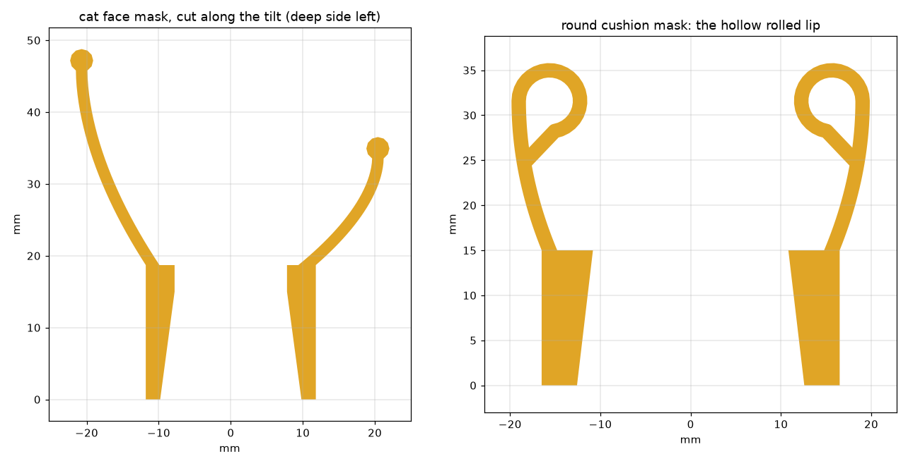

| 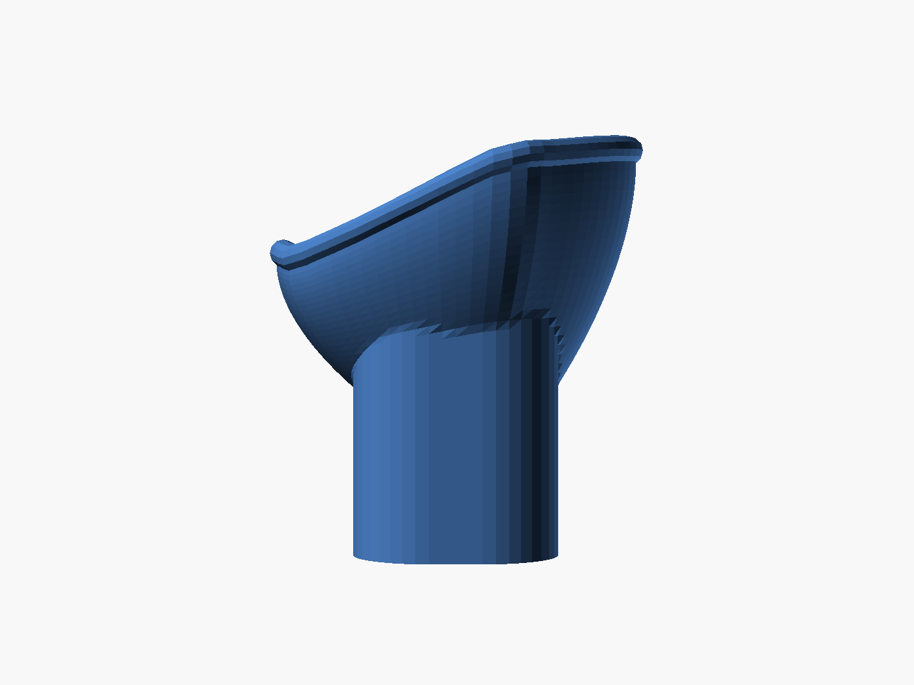 Cat face mask, cut in half | 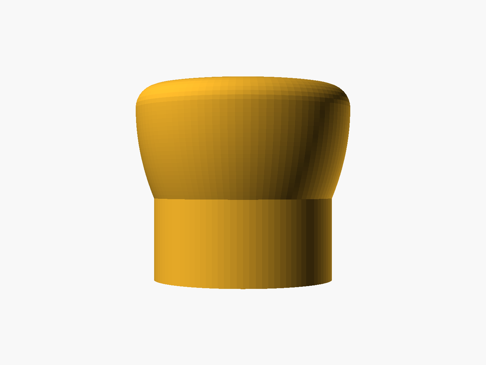 Round mask, cut in half: the hollow lip |
|---|---|

- **Cat face mask.** The rim outline, the 16 degree rim tilt, the non-planar rim wave and the bowl flare were measured from the original mesh and are reproduced as tables, so the shape scales without losing its character. The mask is one closed polyhedron and renders instantly.
- **Round cushion mask.** A revolved profile. The rolled lip is a 260 degree curl of the wall plus a strut back to the inner wall, which closes the hollow so the lip stays soft but printable.
- **Holding chamber.** About 105 ml internal volume by default, which a 3.3 kg cat empties in a few breaths. The inhalation valve is a 20 mm TPU flap on a cross grille; its hinge tab is printed already bent at 90 degrees, because a printed TPU tab keeps the shape it was printed in. The exhalation valve is a 10 mm TPU umbrella recessed in a 3 mm lid plate above the ceiling cone, over six 1.8 mm holes (15 mm2) angled down into the space between the flap and the nozzle, so exhaled air never re-enters the chamber and the cat does not re-breathe it. The vestibule and mask hold roughly 30 ml of dead space, which is why the exhalation valve matters for a small cat.
- **Materials.** Non-antistatic plastic attracts aerosol; the dish-soap wash is the standard spacer trick for that. Printed valves are stiffer than silicone ones, so thin is good: 0.6 mm for the flap, 0.4 mm for the umbrella.

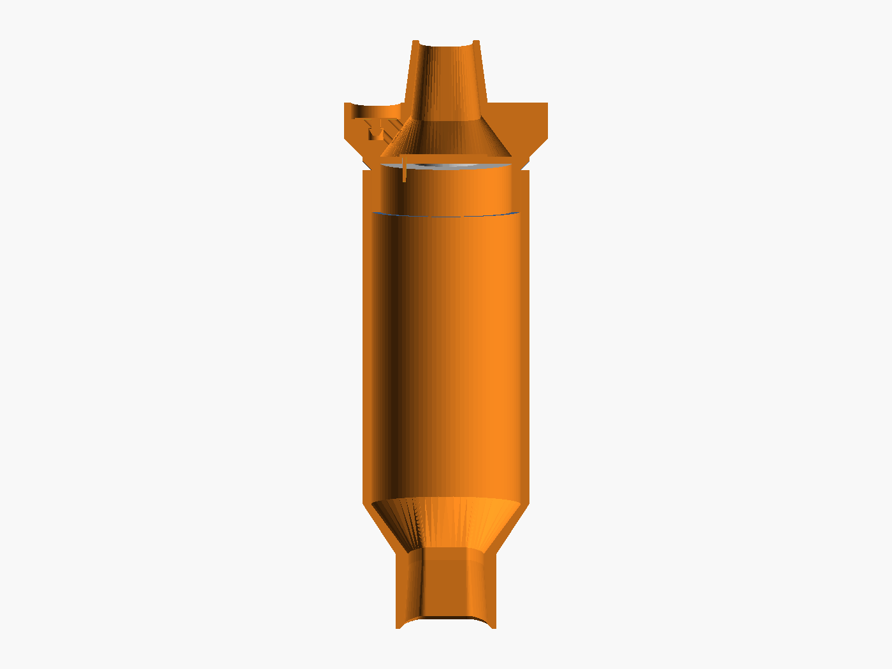
